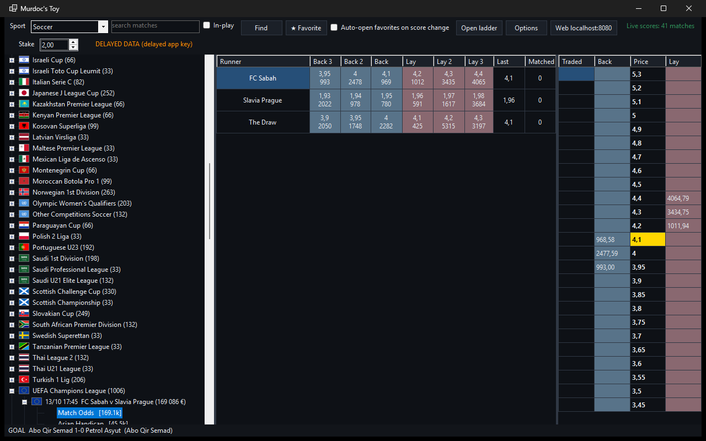
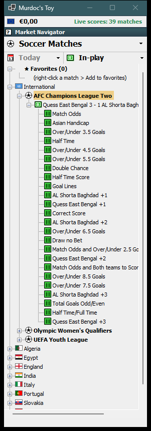
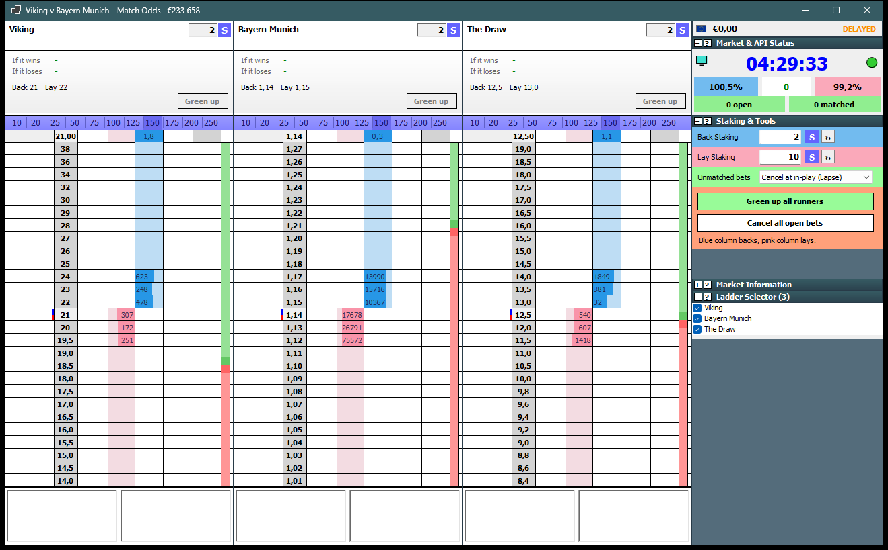
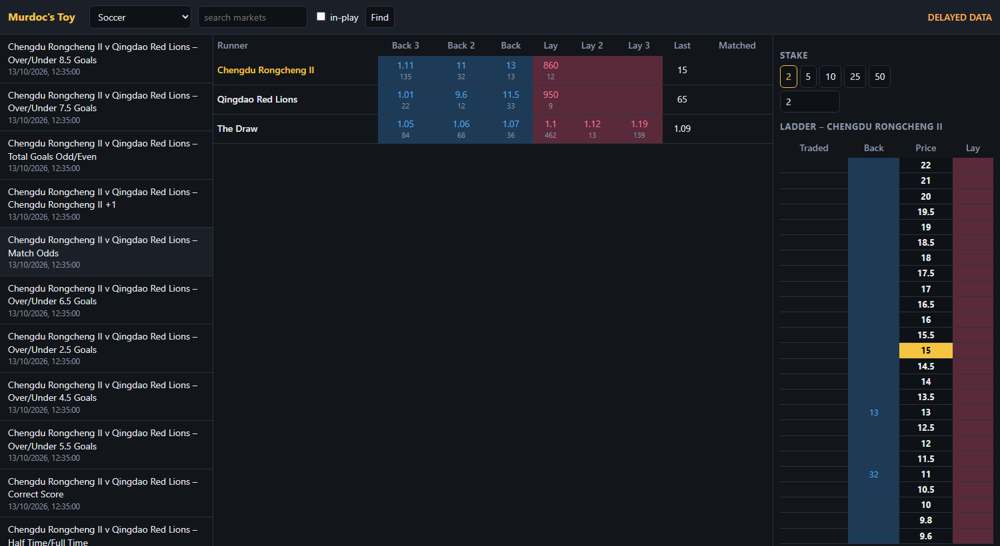
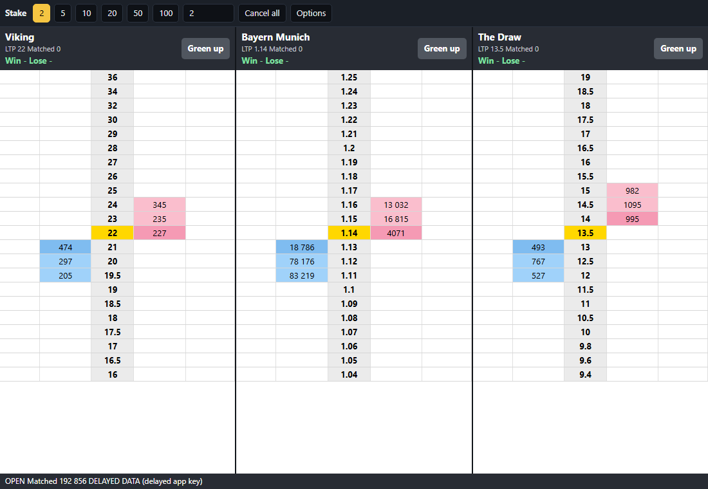
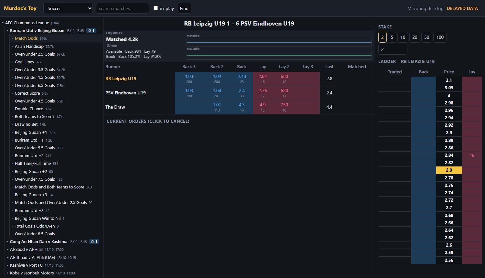

# Murdoc's Toy

An open-source Betfair Exchange trading client for Windows, with a browser UI that mirrors it.

- **Desktop** (`src/MurdocsToy.Desktop`, C# / WinForms) in three interfaces you pick at login: **Modern (dark)**, **Modern (light)** and **Classic**.
- **Web** (`web/`, dependency-free Node server + single-page UI). While the desktop app runs it serves this UI itself and mirrors what you are looking at.

Everything uses only Betfair's public, documented [Exchange API-NG](https://betfair-developer-docs.atlassian.net/wiki/spaces/1smk3cen4v3lu3yomq5qye0ni/overview). This is an independent, clean-room project: all code and artwork are original, and it is not affiliated with Betfair.

## Interfaces

Choose one in the **Interface** box on the login form (Classic is the default; your choice is remembered; `--ui=dark|light|classic` overrides it).

**Modern (dark / light)**: tree explorer on the left, selected market on the right, pop-up ladders. Dark mode includes a dark title bar and dark menus.



**Classic**: a dense, traditional trading layout. A narrow navigator window with the account balance, a sport header, *Today / Tomorrow / Next 2 days / In-play* and *All / Favorites* filters, and a **country > competition > match > market** tree with flags. Each match opens in a trading window with a **ladder per runner side by side** (name and stake header, position panel, bar-scale strip, summary row, price rows with a grey price column, pink *lay* and blue *back* columns, your own orders, traded volume, a green/red depth bar and order boxes) next to a slate **tools panel**: clock, book percentages, back and lay staking (lay can be stake or liability), bet persistence, *Green up all*, *Cancel all*, market information and a ladder selector. The window title shows the matched amount, e.g. `Viking v Bayern Munich - Match Odds   €233 658`.





## Features

- **Tree explorer**: sport > competition > match > markets, loaded as you expand. **Country flags** mark every competition and match. Search finds matches by name; the *In-play* filter works for every sport.
- **Match label with score and volume**: `Porto 0 - 1 Benfica (145 643 €)`. Live score between the teams (when a score relay is connected), matched volume after, thousands separated by spaces.
- **Pop-up ladders**: double-click a match to open its Match Odds, one ladder per runner side by side. Open as many as you like.
- **One-click betting**, stake buttons you can edit, custom stakes, cancel-all, bet persistence (lapse / persist / SP), one-click or confirm-every-bet.
- **Position and green up**: profit if each runner wins or loses, and a button that places the hedge bet locking the same profit either way.
- **Favorites**: star a match (★ Favorite, right-click, or ☆ in the browser). Favorites sit in a ★ Favorites section at the top of the tree. Tick **Auto-open favorites on score change** and a favorite's ladder opens (or is brought to the front) whenever its score changes, including a goal being taken away by VAR.
- **Live scores**: point *Options > Live scores relay* at a WebSocket relay broadcasting JSON `snapshot`, `goal` and `var` messages (`home_team`, `away_team`, `home_score`, `away_score`, optional `scoring_team`). Teams are matched to Betfair events by name (accents, "Utd"/"United", FC/SC prefixes, youth/women/reserve squads handled). The standalone web server reads `MT_RELAY_URL`.
- **Liquidity tracker** in every pop-up ladder (Modern) and the Classic status panel: matched volume and per-minute rate, money available to back and lay, book percentages, history charts.
- **Mirror to web**: the desktop app serves the web UI at **http://localhost:8080** (next free port if busy) using its own Betfair session. The browser needs no login, follows the market you select, lists the open ladders and uses your stake buttons. It listens on this machine only, and POSTs need a custom header so other websites cannot place bets.
- **Remembered login**: the password is stored encrypted with Windows DPAPI (only your Windows account can decrypt it); expired sessions renew themselves. *Options > Forget saved login* removes it.
- **Privacy mode**: `--privacy` hides balance and orders (for screenshots and screen sharing).







*Screenshots use a delayed Betfair key and show public market data only.*

## You need

- A Betfair account and an **application key** ([create one](https://apps.betfair.com/visualisers/api-ng-account-operations/) with *Create Developer App Keys*).
- A **delayed** key gives delayed prices (up to a few minutes old). The app still lets you place bets with it, so **whenever prices are delayed every bet asks for confirmation** and says so. Use a live key for real-time prices.
- .NET 8 SDK (to build or run from source) and/or Node 20+ (standalone web server).

## Install (Windows)

Download `MurdocsToy-Setup-0.4.1.exe` from the [Releases](../../releases) page and run it. It needs no .NET install, adds a Start Menu entry and an optional desktop shortcut, and can be removed from *Apps & features*. Windows SmartScreen may warn because the installer is unsigned.

On first launch enter your Betfair username, password and application key, and pick an interface.

To build the installer yourself:

```bash
dotnet publish src/MurdocsToy.Desktop -c Release -r win-x64 --self-contained true \
  -p:PublishSingleFile=true -p:IncludeNativeLibrariesForSelfExtract=true -o dist/app
ISCC.exe installer/MurdocsToy.iss      # needs Inno Setup 6 -> dist/MurdocsToy-Setup-0.4.1.exe
```

## Configure

Desktop: type the details into the login form once. Standalone web server: environment variables or a `.env.local` file next to `web/` or in the repo root (loaded automatically, gitignored), or the browser login form, which remembers your username and app key. Never commit credentials: `.env*` is gitignored.

```
BETFAIR_USERNAME=...
BETFAIR_PASSWORD=...
BETFAIR_APP_KEY=...
MT_RELAY_URL=ws://relay-host:9001     # optional live-score relay
```

## Run from source

```bash
# standalone web UI -> http://localhost:8080  (not needed while the desktop app runs; it serves the same page)
cd web && node server.mjs

# desktop UI (Windows)
dotnet run --project src/MurdocsToy.Desktop -- --ui=classic
```

## Test

```bash
dotnet test                 # unit tests, plus live API tests when BETFAIR_* are set
cd web && node --test test.mjs
```

The desktop app also has `--smoke`, which logs in, loads a market and writes `smoke.txt` next to the executable.

## Status

Verified against the live API: login, event types, competitions, events by date window and in-play, market catalogue, market book with depth and traded volume, per-match volumes, account funds and details, current orders. The order path was exercised once: Betfair received the request and rejected it with `INSUFFICIENT_FUNDS` (the test account was empty), so a **matched bet has not been tested**. Treat order placement as unproven and start with small stakes.

## Safety

Betting carries financial risk. Delayed prices can be wrong. This software is provided as-is with no warranty (see `LICENSE`).

## Credits

Country flags: [flag-icons](https://github.com/lipis/flag-icons) (MIT), rendered to PNG; its licence is in `web/public/flags/LICENSE-flag-icons.txt`. Country names and ISO codes come from `pycountry` data.

## License

MIT
