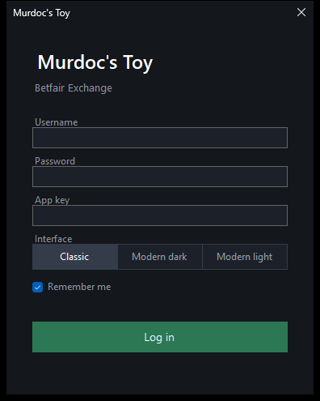
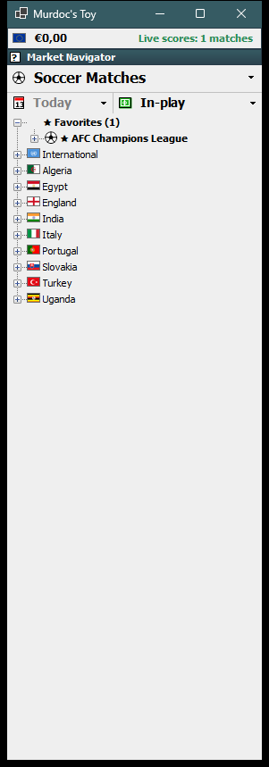
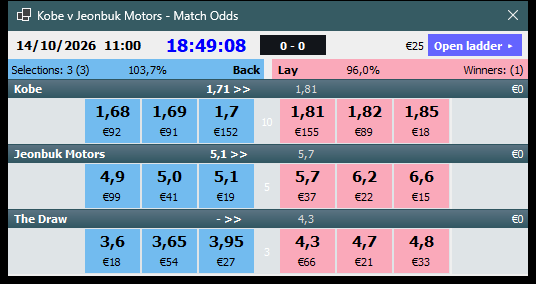
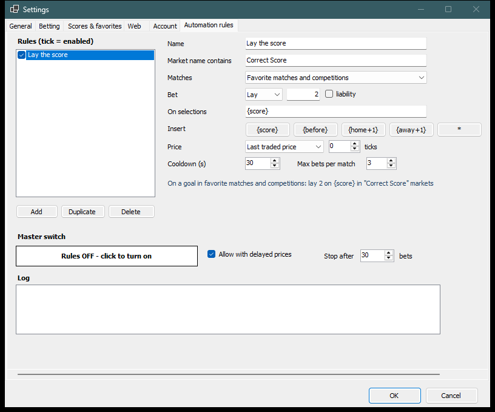
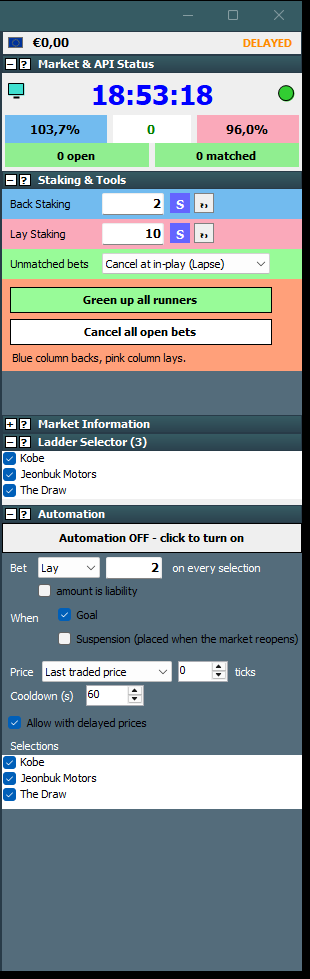

# Murdoc's Toy

An open-source Betfair Exchange trading client for Windows, with a browser UI that mirrors it.

- **Desktop** (`src/MurdocsToy.Desktop`, C# / WinForms) with the **Classic** interface: a dense, traditional trading layout. (Two older *Modern* interfaces are still in the code but deprecated and not offered.)
- **Web** (`web/`, dependency-free Node server + single-page UI). While the desktop app runs it serves this UI itself and mirrors what you are looking at.

Everything uses only Betfair's public, documented [Exchange API-NG](https://betfair-developer-docs.atlassian.net/wiki/spaces/1smk3cen4v3lu3yomq5qye0ni/overview). This is an independent, clean-room project: all code and artwork are original, and it is not affiliated with Betfair.

## Interface

The app opens in the **Classic** interface. The earlier *Modern dark/light* interfaces are **deprecated**: the code is kept, but they are not offered at login and get no new features (start with `--ui=dark` or `--ui=light` to see them).



**Classic**: a dense, traditional trading layout. A narrow navigator window with the account balance, a sport header, a date filter (*Today / Tomorrow / Next 2 days*) and a scope filter (*All / In-play / Favorites*, opening on In-play), and a **country > competition > match > market** tree with flags. Each match opens in a trading window with a **ladder per runner side by side** (name and stake header, position panel, bar-scale strip, summary row, price rows with a grey price column, pink *lay* and blue *back* columns, your own orders, traded volume, a green/red depth bar and order boxes) next to a slate **tools panel**: clock, book percentages, back and lay staking (lay can be stake or liability), bet persistence, *Green up all*, *Cancel all*, market information and a ladder selector. The window title shows the matched amount, e.g. `Viking v Bayern Munich - Match Odds   €233 658`.





### Classic extras

- **Card**: minimize a Classic ladder and it turns into a small card: date and time, clock, live score, matched amount, back/lay book percentages and, per selection, the last price with its trend and the three best back and lay prices with the money on each. Press **Open ladder** (or double-click it) to bring the full ladder back. *Open card only* in the navigator's right-click menu opens a market straight into a card.



- **Automation** (below the ladder selector): one switch, **OFF or ON**. When ON, a **goal** (reported by the score relay) or a **suspension** (bets go in the moment the market reopens, since Betfair refuses bets while suspended) places a bet you configure on every ticked selection: back or lay, an amount (or liability for lay), priced from the **last traded price** or the **best available price**, moved a number of **ticks** up or down the Betfair price ladder. It asks you to confirm when you turn it on, showing the worst-case loss, has a cooldown between firings, stops after 20 bets or 3 failures in a row, and refuses to act on delayed prices unless you allow it. It always starts OFF.
- **Live video panel**: click the little screen in the status panel. A small browser (Edge WebView2) opens inside the ladder window on the market's page on betfair.com; log in to the website there once and Betfair's own player appears for the events your account is eligible for. Shift-click opens your normal browser instead. The app never handles the video stream (Betfair does not offer it through the API).
- **Settings** (right-click the balance bar at the top of the navigator): General, Betting (preset stakes, back stake, lay amount or liability, bet persistence, confirm every bet), Scores & favorites (relay address, auto-open, remove favorite matches and competitions), Web, Account (forget saved login) and **Automation rules**.
- **Automation rules**: a whole tab for rules that work across markets, not just the ladder you have open. A rule says *which markets* (the name contains, e.g. "Correct Score"), *which matches* (your favorites by default, or matches with an open ladder, or any match with a live score), and *what to bet*: back or lay, an amount (or liability), on named selections, priced from the last traded price (or the best available) plus or minus ticks. Selections can follow the game with tokens: `{score}` is the score now, `{before}` the score before the goal, `{home+1}` and `{away+1}` the score if the next goal goes to the home or away side. Example: *on a goal, lay `{score}` in Correct Score*. A goal means the total goals went up (a goal taken away by VAR does not count); if the market is suspended the bets wait up to 90 seconds for it to reopen. One master switch, **always OFF at start-up**, turns the rules on after a confirmation; a cooldown per rule and match, a cap on bets per match and per session, a stop after 3 failures in a row, and no bets on delayed prices unless you allow it. A red **RULES ON** badge shows in the navigator while they are on. The tab keeps a log of everything the rules did.



- **Hover help**: every control and every region of the ladder explains itself when you hover over it.
- **Auto-expand**: a tree level with a single choice opens by itself.



## Features

- **Tree explorer**: sport > competition > match > markets, loaded as you expand. **Country flags** mark every competition and match. Search finds matches by name; the *In-play* filter works for every sport.
- **Match label with score and volume**: `Porto 0 - 1 Benfica (145 643 €)`. Live score between the teams (when a score relay is connected), matched volume after, thousands separated by spaces.
- **Pop-up ladders**: click a match to open its Match Odds, one ladder per runner side by side. Open as many as you like.
- **One-click betting**, stake buttons you can edit, custom stakes, cancel-all, bet persistence (lapse / persist / SP), one-click or confirm-every-bet.
- **Position and green up**: profit if each runner wins or loses, and a button that places the hedge bet locking the same profit either way.
- **Horse racing and greyhounds**: races have no competitions, so the tree is **country > meeting > race** (races in time order with the start time in front). If nothing is in-play it shows today's schedule. A race opens with its four shortest-priced runners and a narrower window; tick the rest in the Ladder Selector. Favorites belong to the sport you are looking at.
- **Favorites** (matches and competitions): star a match (★ Favorite, right-click, or ☆ in the browser) or a whole **competition** such as AFC Champions League or Primeira Liga (right-click it in the desktop tree, press ★ Favorite on it, or ☆ next to it in the browser). Favorites sit in a ★ Favorites section at the top of the tree; a favorite competition expands to its matches. Tick **Auto-open favorites on score change** and the ladder of any starred match, or of any match in a starred competition, opens (or is brought to the front) whenever its score changes, including a goal being taken away by VAR.
- **Live scores**: point *Options > Live scores relay* at a WebSocket relay broadcasting JSON `snapshot`, `goal` and `var` messages (`home_team`, `away_team`, `home_score`, `away_score`, optional `scoring_team`). Teams are matched to Betfair events by name (accents, "Utd"/"United", FC/SC prefixes, youth/women/reserve squads handled). The standalone web server reads `MT_RELAY_URL`.
- **Liquidity**: the Classic status panel shows matched volume and per-minute rate, money available to back and lay, book percentages, history charts.
- **Mirror to web**: the desktop app serves the web UI at **http://localhost:8080** (next free port if busy) using its own Betfair session. The browser needs no login, follows the market you select, lists the open ladders and uses your stake buttons. It listens on this machine only, and POSTs need a custom header so other websites cannot place bets.
- **Remembered login**: the password is stored encrypted with Windows DPAPI (only your Windows account can decrypt it); expired sessions renew themselves. *Options > Forget saved login* removes it.
- **Privacy mode**: `--privacy` hides balance and orders (for screenshots and screen sharing).


*Screenshots use a delayed Betfair key and show public market data only.*

## You need

- A Betfair account and an **application key** ([create one](https://apps.betfair.com/visualisers/api-ng-account-operations/) with *Create Developer App Keys*).
- A **delayed** key gives delayed prices (up to a few minutes old). The app still lets you place bets with it, so **whenever prices are delayed every bet asks for confirmation** and says so. Use a live key for real-time prices.
- .NET 8 SDK (to build or run from source) and/or Node 20+ (standalone web server).

## Install (Windows)

Download `MurdocsToy-Setup-0.6.2.exe` from the [Releases](../../releases) page and run it. It needs no .NET install, adds a Start Menu entry and an optional desktop shortcut, and can be removed from *Apps & features*. Windows SmartScreen may warn because the installer is unsigned.

On first launch enter your Betfair username, password and application key, and pick an interface.

To build the installer yourself:

```bash
dotnet publish src/MurdocsToy.Desktop -c Release -r win-x64 --self-contained true \
  -p:PublishSingleFile=true -p:IncludeNativeLibrariesForSelfExtract=true -o dist/app
ISCC.exe installer/MurdocsToy.iss      # needs Inno Setup 6 -> dist/MurdocsToy-Setup-0.6.2.exe
```

## Configure

Desktop: type the details into the login form once. Standalone web server: environment variables or a `.env.local` file next to `web/` or in the repo root (loaded automatically, gitignored), or the browser login form, which remembers your username and app key. Never commit credentials: `.env*` is gitignored.

```
BETFAIR_USERNAME=...
BETFAIR_PASSWORD=...
BETFAIR_APP_KEY=...
MT_RELAY_URL=ws://relay-host:9001     # optional live-score relay
```

## Run from source

```bash
# standalone web UI -> http://localhost:8080  (not needed while the desktop app runs; it serves the same page)
cd web && node server.mjs

# desktop UI (Windows)
dotnet run --project src/MurdocsToy.Desktop -- --ui=classic
```

## Test

```bash
dotnet test                 # unit tests, plus live API tests when BETFAIR_* are set
cd web && node --test test.mjs
```

The desktop app also has `--smoke`, which logs in, loads a market and writes `smoke.txt` next to the executable.

## Status

Verified against the live API: login, event types, competitions, events by date window and in-play, market catalogue, market book with depth and traded volume, per-match volumes, account funds and details, current orders. The order path was exercised once: Betfair received the request and rejected it with `INSUFFICIENT_FUNDS` (the test account was empty), so a **matched bet has not been tested**. Treat order placement as unproven and start with small stakes.

## Safety

Betting carries financial risk. Delayed prices can be wrong. This software is provided as-is with no warranty (see `LICENSE`).

## Credits

Country flags: [flag-icons](https://github.com/lipis/flag-icons) (MIT), rendered to PNG; its licence is in `web/public/flags/LICENSE-flag-icons.txt`. Country names and ISO codes come from `pycountry` data.

## License

MIT
