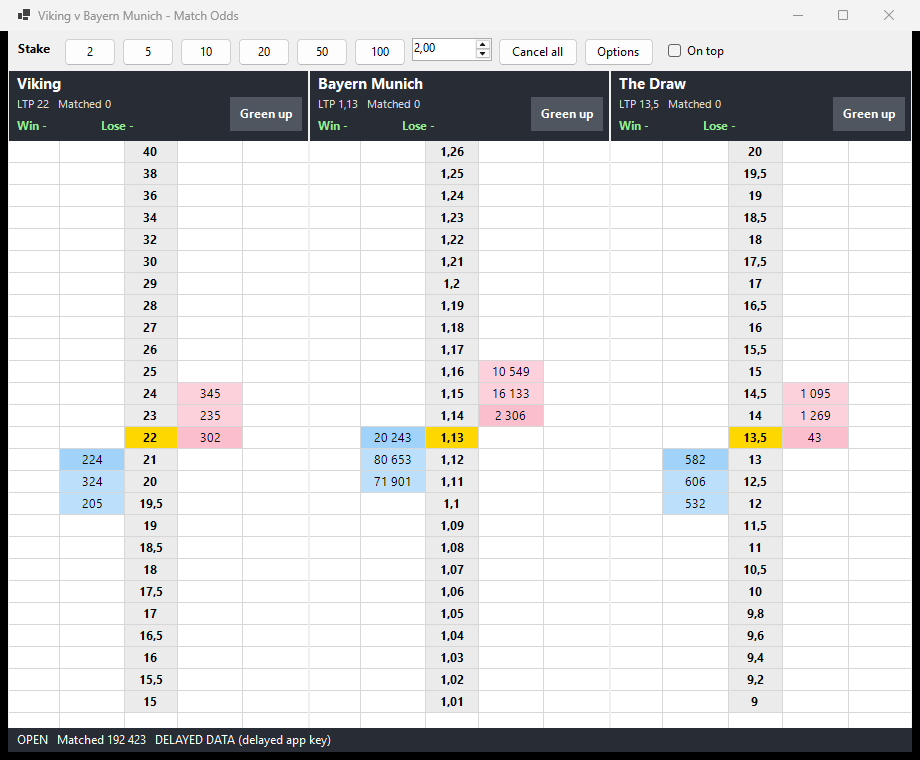

# Murdoc's Toy

An open-source Betfair Exchange trading client with two front ends:

- **Desktop** (`src/MurdocsToy.Desktop`) – C# / WinForms: market browser, runner grid with 3-deep back/lay, price ladder with click-to-bet, current orders, balance.
- **Web** (`web/`) – dependency-free Node server plus a dark single-page UI with the same features and a cleaner layout.

Both use only Betfair's public, documented [Exchange API-NG](https://betfair-developer-docs.atlassian.net/wiki/spaces/1smk3cen4v3lu3yomq5qye0ni/overview). This is an independent, clean-room project. It contains no code from any commercial trading product and is not affiliated with Betfair.

## Features

- **Tree explorer**: sport > competition > match > markets. Children load when you expand a node, so a match's dozens of markets stay out of the way. Search finds matches by name; the *In-play* box filters to live games.
- **Pop-up ladders**: double-click a match (or press *Open ladder*) and its Match Odds open in their own window with one ladder per runner side by side (Home / Draw / Away). Open as many as you like.
- **One-click betting**: click the blue *Back* or pink *Lay* column at a price to bet your selected stake. Click the orders column to cancel your unmatched bets at that price. *Cancel all* clears the market.
- **Custom stakes and options**: stake buttons and the stake box are yours to edit (*Options*): stake presets, default stake, row height, font size, refresh rate, back/lay colours, bet persistence, one-click or confirm-every-bet, always on top, auto-centre.
- **Position and green up**: each ladder shows your profit if that runner wins or loses and a *Green up* button that places the hedge bet locking the same profit either way.
- **Privacy mode**: `--privacy` hides balance and orders (for screenshots or screen sharing).

## Screenshots

**Desktop**: tree explorer, runner grid and ladder.


**Pop-up ladder** (desktop): Home / Draw / Away ladders, stake buttons, green up.



**Web UI**: same tree explorer in the browser.


**Web pop-up ladder**: opened by double-clicking a match.


*Screenshots use a delayed Betfair key (data is delayed) and show public market data only.*

## You need

- A Betfair account and an **application key** ([create one](https://apps.betfair.com/visualisers/api-ng-account-operations/) with *Create Developer App Keys*).
  - A **delayed** key lets you browse markets, prices and the ladder (data is delayed). **Placing and cancelling bets needs a live key**, which Betfair activates on request.
- .NET 8 SDK (desktop, tests) and/or Node 20+ (web).

## Install (Windows)

Download `MurdocsToy-Setup-0.2.0.exe` from the [Releases](../../releases) page and run it. It needs no .NET install, adds a Start Menu entry and an optional desktop shortcut, and can be removed from *Apps & features*. Windows SmartScreen may warn because the installer is unsigned.

On first launch enter your Betfair username, password and application key. The username and key are remembered in `%APPDATA%\MurdocsToy\settings.json`; the password is never stored.

To build the installer yourself:

```bash
dotnet publish src/MurdocsToy.Desktop -c Release -r win-x64 --self-contained true   -p:PublishSingleFile=true -p:IncludeNativeLibrariesForSelfExtract=true -o dist/app
ISCC.exe installer/MurdocsToy.iss      # needs Inno Setup 6 -> dist/MurdocsToy-Setup-0.2.0.exe
```

## Configure

Credentials are read from environment variables (or typed into the login form). Never commit them: `.env*` is gitignored.

```
BETFAIR_USERNAME=...
BETFAIR_PASSWORD=...
BETFAIR_APP_KEY=...
```

## Run from source

```bash
# web UI -> http://localhost:8080  (binds to localhost only)
cd web && node server.mjs

# desktop UI (Windows)
dotnet run --project src/MurdocsToy.Desktop
```

## Test

```bash
dotnet test                 # ladder unit tests + live API test when BETFAIR_* are set
cd web && node --test test.mjs
```

The desktop app also has `--smoke`, which logs in, loads a market and writes `smoke.txt` next to the executable.

## Status

Verified against the live API with a delayed key: login, event types, market catalogue, market book with depth and traded volume, account funds, current orders. Order placement and cancellation are implemented from the API spec and pass input validation, but have **not** been exercised live because that requires a live app key.

## Safety

Betting carries financial risk. Orders require a confirmation click, but this software is provided as-is with no warranty (see `LICENSE`). Test with small stakes.

## License

MIT
